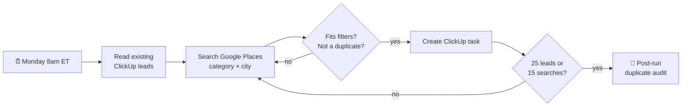

<div align="center">

# 🌴 Tampa Bay Lead Finder

**Every Monday at 8am, 25 fresh, verified small-business leads land in your ClickUp — ready to pitch AI automation.**

[](CHANGELOG.md)
[](LICENSE)
[](https://trigger.dev)
[](https://www.typescriptlang.org/)
[](https://github.com/kryo-o/kryo-workflows/actions/workflows/deploy.yml)

</div>

---

## ✨ What it does

A scheduled [Trigger.dev](https://trigger.dev) task that searches Google Maps for established local businesses across the Tampa Bay metro, filters out the ones that aren't a fit, and creates one ClickUp task per lead — **never the same business twice**.

- 🎯 **Targeted** — home services, medical/dental/med spa, and professional services: the businesses drowning in missed calls, scheduling, intake and follow-ups.
- 🏙️ **Wide metro coverage** — Tampa, St. Petersburg, Clearwater, Brandon, Largo, Wesley Chapel, Lakeland, Sarasota, Bradenton, New Port Richey.
- ✅ **Pre-qualified** — operational, has a website *and* phone, 10–300 Google reviews (real budget, not a national chain).
- 🔁 **Rotates searches weekly** — 13 categories × 10 cities = 130 combinations, cycled so each week digs somewhere new.
- 🧹 **Duplicate-proof** — checks before creating *and* audits the whole list after every run.
- 💸 **Costs $0** — fits inside the Google Places, ClickUp and Trigger.dev free tiers.

## 🔍 How it works



Each lead task contains:

```
Category: plumber
City: Largo
Phone: (727) 555-0142
Website: https://example-plumbing.com/
Address: 123 Main St, Largo, FL 33770, USA
Rating: 4.8 (142 reviews)
Google Maps: https://maps.google.com/?cid=...
Place ID: ChIJ...
```

### 🛡️ Duplicate protection

Two leads are treated as the same business if they share **any** of:

| Key | Example | Catches |
|---|---|---|
| Google Place ID | `ChIJ…` | The exact same listing |
| Phone (last 10 digits) | `7275550142` | Same business, duplicate listing |
| Website domain | `example-plumbing.com` | Multi-location businesses |

Shared hosts (facebook.com, business.site, linktr.ee, …) are ignored as a domain key.

1. **Before** creating anything, every existing task in the list (including closed ones) is loaded and indexed.
2. **During** the run, each new lead is added to the index immediately.
3. **After** the run, the full list is re-read and audited. Duplicates created by this run are deleted; older duplicates are only flagged in the logs, so hand-made tasks are never touched.

Runs are limited to one at a time, so two runs can never race past the check.

## 🚀 Setup

### Prerequisites

| Service | What you need | Free tier |
|---|---|---|
| [Trigger.dev](https://cloud.trigger.dev) | A project | ✅ |
| [Google Cloud](https://console.cloud.google.com) | API key with **Places API (New)** enabled | ✅ ~1,000 searches/month |
| [ClickUp](https://clickup.com) | Personal API token + a list | ✅ |
| Node.js | v20+ | — |

### 1. Install

```bash
git clone https://github.com/kryo-o/kryo-workflows.git
cd kryo-workflows
npm install
```

### 2. Configure

Set your Trigger.dev project ref in `trigger.config.ts`, then create a `.env` file:

```bash
# Google Cloud Console → APIs & Services → Credentials (restrict to "Places API (New)")
GOOGLE_PLACES_API_KEY=
# ClickUp → Settings → ClickUp API → Create token
CLICKUP_API_TOKEN=
# The number after /li/ in the list's URL
CLICKUP_LIST_ID=
```

Add the same three variables in the **Trigger.dev dashboard → Environment Variables** for Staging and Prod.

### 3. Test locally

```bash
npx trigger.dev@4.4.0 login   # first time only
npm run dev
```

Then trigger `find-tampa-leads` from the dashboard's **Test** page.

### 4. Deploy

Pushing to `master` deploys automatically via GitHub Actions ([`deploy.yml`](.github/workflows/deploy.yml)). Add a Trigger.dev personal access token as the `TRIGGER_ACCESS_TOKEN` repository secret first.

## ⚙️ Customize

Everything lives at the top of [`src/trigger/tampa-leads/find-leads.ts`](src/trigger/tampa-leads/find-leads.ts):

| Constant | Default | Meaning |
|---|---|---|
| `TARGET_LEADS` | `25` | Leads per run |
| `MAX_SEARCHES` | `15` | Google searches per run (cost cap) |
| `MIN_REVIEWS` / `MAX_REVIEWS` | `10` / `300` | Business size filter |
| `CATEGORIES` | 13 types | What to search for |
| `CITIES` | 10 cities | Where to search |
| `cron` | `0 8 * * 1` (America/New_York) | When to run |

> Keep the number of categories and cities coprime (e.g. 13 and 10) so the weekly rotation reaches every combination.

## 📁 Project structure

```
.
├── src/trigger/tampa-leads/
│   └── find-leads.ts          # The scheduled task
├── .github/workflows/
│   └── deploy.yml             # Auto-deploy on push to master
├── trigger.config.ts          # Trigger.dev project config
└── CHANGELOG.md
```

## 🙏 Credits

Idea inspired by **[Nate Herk](https://www.youtube.com/@nateherk)** and his work on AI automation agencies. Go check out his channel.

Built with [Trigger.dev](https://trigger.dev), the [Google Places API](https://developers.google.com/maps/documentation/places/web-service), and the [ClickUp API](https://clickup.com/api).

## 📄 License

[MIT](LICENSE) © 2026 kryo-o
